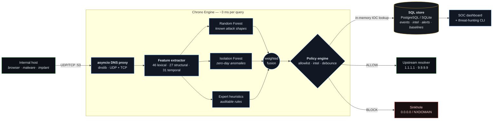

<div align="center">

```
   ______ __                             ____  _   _ _____
  / ____// /_   _____ ____   ____   ____ / __ \/ | / // ___/
 / /    / __ \ / ___// __ \ / __ \ / __ \/ / / /  |/ / \__ \
/ /___ / / / // /   / /_/ // / / // /_/ / /_/ / /|  / ___/ /
\____//_/ /_//_/    \____//_/ /_/ \____/_____/_/ |_/ /____/
```

### ML-Driven DNS Security Gateway &amp; Threat Intelligence Engine

**Catches data walking out of your network through port 53 — in about 3 milliseconds.**

[](LICENSE)
[](https://www.python.org/)
[](https://www.postgresql.org/)
[](https://sqlite.org/)
[](https://scikit-learn.org/)
[](scripts/)
[](docker-compose.yml)
[](tests/)
[](#zero-cost-by-design)

**[Why](#the-problem) · [Architecture](#architecture) · [Quick start](#quick-start) · [See it work](#see-it-work) ·
[Features](#feature-engineering) · [ML](#the-ml-ensemble) · [SQL](#the-sql-threat-engine) ·
[Benchmarks](#performance) · [Honesty](#what-this-does-not-do)**

</div>

---

## The problem

Every firewall on earth blocks the ports it does not recognise. **Nobody blocks port 53**, because
blocking DNS means blocking the internet. Attackers know this.

So they put the data inside the question:

```
                    the attacker controls everything left of the zone
                    ┌──────────────────────────────────────────┐
  Normal:   api . github . com
  Tunnel:   mzxw6ytboi7dnnsxs3dbomruwm4tbm5uwy2ltebvgc4tf . tunnel.example    TXT
            └────────────── base32("your password file") ──────────────┘
```

Every DNS query can smuggle out roughly **40 bytes** of encoded payload in its subdomain. Send
1,000 queries a minute and a 2 MB customer database leaves the building in under an hour, through a
port that is open by policy, in traffic nobody inspects, via a protocol with no authentication.

Three attacker behaviours matter, and each has a different mathematical signature:

| Technique | What it looks like | The tell |
|---|---|---|
| **DNS tunnelling** | `<52 bytes of base32>.tunnel.example` | Entropy near the 4.7 bits/char ceiling, labels pinned at the 63-byte RFC limit, hundreds of unique subdomains under one zone |
| **DGA** (algorithmic C2 domains) | `kqwbxjvmzpdlfr.top` | Unpronounceable — vowel/consonant ratio collapses, n-gram coverage against real hostnames drops to near zero, NXDOMAIN storms |
| **C2 beaconing** | `a3f9.c2.example` every 60.0s | Inter-arrival coefficient of variation σ/μ → 0. Humans are never metronomes |

**Chrono-DNS sits inline as your resolver**, extracts **104 statistical features** from every
question, runs a three-voter ML ensemble, and either forwards the query upstream or sinkholes it —
then writes the whole forensic stream into SQL so an analyst can hunt through it afterwards.

---

## Architecture



The decisive design choice: **there is exactly one `analyse()` function.** The live gateway, the
offline replay tool, the benchmark harness and the test suite all call it. What you measure offline
is byte-for-byte what runs inline — no "research pipeline vs production pipeline" gap.

---

## Quick start

Three commands. No cloud account, no API key, no paid feed, nothing to install beyond pip packages.

```bash
git clone https://github.com/i5designs/chrono-dns.git && cd chrono-dns
./scripts/setup.sh          # venv, deps, database, first trained model  (~90s)
chronodns demo              # the whole pipeline, narrated
```

<details>
<summary><b>Prefer to do it by hand?</b></summary>

```bash
python3 -m venv .venv && source .venv/bin/activate
pip install -r requirements.txt && pip install -e .

chronodns init --reset        # schema + indexes + views + seeded threat intel
chronodns dataset             # labelled synthetic capture
chronodns train --harden      # RF + Isolation Forest ensemble
chronodns replay --fresh      # push it all through the inline engine
chronodns report              # SOC report straight out of SQL
```
</details>

<details>
<summary><b>Windows + WSL2</b></summary>

```powershell
wsl --install -d Ubuntu          # PowerShell, once, then reboot
```
```bash
sudo apt update && sudo apt install -y python3 python3-venv python3-pip dnsutils
cd /mnt/c/Users/<you>/projects   # or clone inside the WSL filesystem — much faster
git clone https://github.com/i5designs/chrono-dns.git && cd chrono-dns
./scripts/setup.sh
```
Everything — Bash scripts, PostgreSQL, the gateway — runs natively in WSL2.
</details>

<details>
<summary><b>Docker (PostgreSQL + gateway + dashboard in one command)</b></summary>

```bash
docker compose up -d --build
dig @127.0.0.1 -p 5353 github.com
open http://127.0.0.1:8088
```
</details>

### Then point a real resolver at it

```bash
chronodns serve                 # inline gateway on 127.0.0.1:5353

# in another terminal
dig @127.0.0.1 -p 5353 github.com
dig @127.0.0.1 -p 5353 TXT mzxw6ytboi7dnnsxs3dbomruwm4tbm5uwy2ltebvgc4tf.tunnel.example
```

```text
;; github.com.       A   140.82.112.4        ← forwarded upstream, cached
;; tunnel.example.   TXT ->  NXDOMAIN        ← sinkholed, alert raised, logged to SQL
```

---

## See it work

Everything below is **real, unedited output** from this repository.

### One query, fully explained

```console
$ chronodns explain mzxw6ytboi7dnnsxs3dbomruwm4tbm5uwy2ltebvgc4tfnzuw4zs.tunnel.example --qtype NULL

╭────────────────────────────────── verdict ──────────────────────────────────╮
│ mzxw6ytboi7dnnsxs3dbomruwm4tbm5uwy2ltebvgc4tfnzuw4zs.tunnel.example  (NULL) │
│                                                                             │
│ verdict        BLOCK                                                        │
│ threat class   tunneling                                                    │
│ fused score    0.8564  █████████████████████████·····                       │
│   supervised   0.7878  ███████████████·····                                 │
│   anomaly      1.0000  ████████████████████                                 │
│   heuristic    0.9620  ███████████████████·                                 │
│ latency        10.461 ms                                                    │
╰─────────────────────────────────────────────────────────────────────────────╯
                              Why
╭───┬──────────────────────────────────────────────────────────╮
│ # │ reason                                                   │
├───┼──────────────────────────────────────────────────────────┤
│ 1 │ threat-intel zone match 'tunnel.example' (tunnel, sev 9) │
│ 2 │ very high subdomain entropy 4.47 bits/char over 52B      │
│ 3 │ label 52B — 83% of the RFC cap                           │
│ 4 │ pure base32 alphabet across 52B — encoded payload        │
│ 5 │ payload is incompressible — not natural language         │
│ 6 │ NULL record — almost never legitimate                    │
│ 7 │ 6 consecutive consonants                                 │
│ 8 │ no recognisable hostname vocabulary                      │
╰───┴──────────────────────────────────────────────────────────╯
```

…and the same pipeline on a legitimate CDN hostname that *looks* just as random:

```console
$ chronodns explain e4821-a9f3c2d1b7e.akamaiedge.net

╭─────────────────────── verdict ───────────────────────╮
│ e4821-a9f3c2d1b7e.akamaiedge.net  (A)                 │
│                                                       │
│ verdict        ALLOW                                  │
│ threat class   benign                                 │
│ fused score    0.1328  ███··························· │
│   supervised   0.0165  ····················           │
│   anomaly      0.3153  ██████··············           │
│   heuristic    0.3935  ███████·············           │
╰───────────────────────────────────────────────────────╯
```

> The 10 ms above is a **cold, single-query CLI invocation** — it pays the Isolation Forest's
> first-call cost on its own. Steady-state inline latency is p50 2.93 ms (see the replay below).
>
> That second example is the whole game. Any first-year "entropy > 3.5 = block" detector takes the
> corporate CDN offline on day one. Getting the **negatives** right is harder than getting the
> positives right.

### The live SOC console

```console
$ chronodns live
```
```text
╭────────────────────────────────────────── live gateway ──────────────────────────────────────────╮
│ CHRONO-DNS v1.0.0  model v1-20260913-047f4408ea   uptime   12.0s   rate  17.8 q/s   p95 10.69 ms │
│ features 104                                                                                     │
│                                                                                                  │
│       ALLOW                 MONITOR                    SUSPICIOUS                  BLOCKED       │
│        160                     2                            1                         50         │
╰──────────────────────────────────────────────────────────────────────────────────────────────────╯
╭────────────────────────────────────────── query stream ──────────────────────────────────────────╮
│   time       verdict        score   class         source           query                         │
│  ──────────────────────────────────────────────────────────────────────────────────────────────  │
│   12:52:00   ALLOW          0.066   benign        10.10.7.113      imap7.amazon.com              │
│   12:52:00   BLOCK          0.717   tunneling     10.20.4.88       001d.90f6b0d244f9cc0ced252…   │
│   12:52:00   ALLOW          0.115   benign        10.10.8.138      smtp.stackoverflow.com        │
╰──────────────────────────────────────────────────────────────────────────────────────────────────╯
╭─────────────────────────────────── rollup  ·  ctrl-c to stop ────────────────────────────────────╮
│   threat class   count                            blocked                          reason        │
│  ───────────────────────────────────────────     ──────────────────────────────────────────────  │
│   benign           160   ████████████····         001d.90f6b0d244f9cc0ced252b419   threat-int…   │
│   tunneling         30   ██··············                                          zone match    │
│   dga               21   █···············                                          'c2.exampl…   │
│   c2_beacon          2   ················                                          (c2, sev      │
╰──────────────────────────────────────────────────────────────────────────────────────────────────╯
```

### Replaying a full capture through the inline engine

```console
$ chronodns replay --data data/capture.csv --fresh

                                 Replay result
╭─────────────────────────┬──────────────────────────┬─────────────────────────╮
│ metric                  │ value                    │                         │
├─────────────────────────┼──────────────────────────┼─────────────────────────┤
│ queries analysed        │ 9,675                    │                         │
│ wall time               │ 36.84s                   │                         │
│ throughput              │ 263 q/s                  │                         │
│ p50 / p95 / p99 latency │ 2.933 / 9.666 / 10.699ms │                         │
│ blocked                 │ 2,211                    │ █████···················│
│ suspicious              │ 4                        │                         │
│ true threats in capture │ 2,215                    │                         │
│ threats caught          │ 2,215                    │ 100.00% recall          │
│ false positives         │ 0                        │ 0.0000% of benign       │
│ rows persisted          │ 9,675                    │                         │
╰─────────────────────────┴──────────────────────────┴─────────────────────────╯
      Detected threat classes
╭───────────┬────────────┬─────────╮
│ class     │ detections │ blocked │
├───────────┼────────────┼─────────┤
│ benign    │ 7,457      │ 0       │
│ tunneling │ 1,441      │ 1,440   │
│ dga       │ 642        │ 636     │
│ c2_beacon │ 135        │ 135     │
╰───────────┴────────────┴─────────╯
```

> **Full transcript:** every command in this section, captured end to end, is in
> **[docs/demo_output.txt](docs/demo_output.txt)** — 473 lines, unedited.

### The SOC report — every panel is a SQL query

```console
$ chronodns report

         Exfiltration leaderboard (zones by uploaded subdomain bytes)
╭────────────────┬─────────┬─────────────┬──────────┬─────────────────┬───────╮
│ zone           │ queries │ unique subs │ bytes up │ avg sub entropy │ hosts │
├────────────────┼─────────┼─────────────┼──────────┼─────────────────┼───────┤
│ exfil.example  │ 600     │ 600         │ 47,281   │ 4.700           │ 3     │
│ c2.example     │ 555     │ 555         │ 38,264   │ 3.644           │ 4     │
│ tunnel.example │ 420     │ 420         │ 37,726   │ 4.746           │ 1     │
│ rbl.invalid    │ 138     │ 138         │ 4,125    │ 4.125           │ 31    │
│ sophosxl.net   │ 112     │ 112         │ 3,276    │ 4.110           │ 34    │
╰────────────────┴─────────┴─────────────┴──────────┴─────────────────┴───────╯
```

> Note rows 4 and 5: antivirus and RBL reputation lookups *legitimately* encode hashes into
> subdomains. They rank high on raw volume and low on threat score. A leaderboard is a lead, not a
> verdict — which is exactly why the ML layer exists on top of the SQL layer.

### Threat hunting with window functions

```console
$ chronodns hunt beacons

                    Beacon candidates (lowest jitter first)
╭──────────────┬─────────────┬─────────┬────────────┬─────────────┬────────────╮
│ source_ip    │ registrable │ samples │ interval_s │ variance_s2 │ cv_squared │
├──────────────┼─────────────┼─────────┼────────────┼─────────────┼────────────┤
│ 10.40.31.66  │ c2.example  │ 44      │ 59.96      │ 0.6638      │ 0.00018    │
│ 10.40.47.92  │ c2.example  │ 44      │ 299.42     │ 67.8389     │ 0.00076    │
│ 10.10.40.251 │ apple.com   │ 29      │ 300.69     │ 156.1236    │ 0.00173    │
│ 10.10.47.167 │ apple.com   │ 29      │ 59.83      │ 6.5335      │ 0.00183    │
╰──────────────┴─────────────┴─────────┴────────────┴─────────────┴────────────╯
```

Rows 1–2 are the C2 implants. Rows 3–4 are **macOS software update checks** — also perfectly
periodic, also completely benign. The SQL finds the pattern; the ensemble decides what it means.

---

## Feature engineering

**104 features** per query, in a frozen order so a model trained today still lines up with a gateway
running next year. Run `chronodns features` for the annotated list.

<table>
<tr><th width="120">Group</th><th width="60">Count</th><th>The idea</th></tr>
<tr><td><b>Lexical</b></td><td align="center"><b>46</b></td>
<td>Information theory over the query string. A human-chosen hostname is low-entropy,
pronounceable and dictionary-adjacent. An encoded payload is none of those things.</td></tr>
<tr><td><b>Structural</b></td><td align="center"><b>27</b></td>
<td>The <i>shape</i> of the query and the record type abused. RFC 1035 caps a label at 63 bytes,
so tunnels sit right at the ceiling; TXT and NULL carry the most payload.</td></tr>
<tr><td><b>Temporal</b></td><td align="center"><b>31</b></td>
<td>Stateful rolling windows per host and per zone. This is where beaconing and sustained
exfiltration live — signals no single packet can reveal.</td></tr>
</table>

### The mathematics that actually does the work

**Shannon entropy** — bits of information per character:

$$H(X) = -\sum_{i} p(x_i)\log_2 p(x_i)$$

| String | H(X) | Reading |
|---|---:|---|
| `apigithubcom` | 3.42 | ordinary hostname |
| `mzxw6ytboi7dnnsxs3dbomruwm4tb…` | 4.27 | base32 — near the 4.7 ceiling for a 32-symbol alphabet |

**N-gram coverage** — the fraction of the string's letter pairs that occur in real hostnames. Unlike
entropy, this compares against an *external* reference, so it stays meaningful at any length:

| String | bigram coverage | trigram |
|---|---:|---:|
| `loginmicrosoftonlinecom` | 0.909 | 0.333 |
| `apigithubcom` | 0.727 | 0.300 |
| `mzxw6ytboi7dnnsxs3dbomruwm4tb…` | 0.368 | 0.027 |
| `kqwbxjvmzpdlfr` *(DGA)* | 0.154 | 0.000 |

**Coefficient of variation of inter-arrival times** — the beaconing detector:

$$\mathrm{CV} = \frac{\sigma(\Delta t)}{\mu(\Delta t)} \qquad
\mathrm{CV}\to 0 \;\Rightarrow\; \text{machine} \qquad
\mathrm{CV} > 1 \;\Rightarrow\; \text{human}$$

**Burstiness** (Goh &amp; Barabási) — the same signal from the other direction:

$$B = \frac{\sigma - \mu}{\sigma + \mu} \in [-1, 1] \qquad
-1 = \text{metronome}, \quad 0 = \text{Poisson}, \quad +1 = \text{human bursts}$$

Plus: Rényi and min-entropy, conditional entropy, zlib compression ratio (a Kolmogorov-complexity
proxy), index of coincidence, χ² against English letter frequencies, vowel/consonant ratios,
longest consonant run, character-class transition rate, base32/base64/hex alphabet conformance,
RFC-limit saturation, TLD abuse scoring, per-zone subdomain novelty, upload byte-rate, NXDOMAIN
burst counters, autocorrelation periodicity, and the Fano factor.

Full annotated reference: **[docs/FEATURES.md](docs/FEATURES.md)**

---

## The ML ensemble

Three independent voters. They are kept **separate rather than stacked into one opaque model**, so
that when the gateway blocks something an analyst can see *which* voter objected and why.

```
                     ┌──────────────────────────────┐
  104-dim vector ──► │ Random Forest   (200 trees)  │──► P(threat)   weight 0.65
                     │ supervised, 4-class          │
                     ├──────────────────────────────┤
                 ──► │ Isolation Forest (96 trees)  │──► anomaly     weight 0.20
                     │ trained on BENIGN ONLY       │
                     ├──────────────────────────────┤
                 ──► │ Expert heuristics (12 rules) │──► evidence    weight 0.15
                     │ deterministic, auditable     │
                     └──────────────────────────────┘
                                    │
              fused ∈ [0,1] ────────┴──────► < 0.45 ALLOW │ < 0.70 MONITOR │ ≥ 0.70 BLOCK
```

**Why an Isolation Forest trained only on benign traffic?** The Random Forest can only recognise
attack families it has seen. The Isolation Forest learns the manifold of *normal* and flags anything
far from it — including families that did not exist at training time. It is the zero-day voter, and
fitting it on the full mix would teach it that attacks are normal, destroying exactly the property
it exists for.

**Why keep hand-written rules in 2026?** Three reasons that matter in production: the gateway must
make decisions on day zero before any model is trained; "blocked: 52-byte base32 label on a NULL
record" is an answer an auditor accepts and `p=0.94` is not; and an attacker who reverse-engineers
the model still cannot push a 63-byte high-entropy label past a hard rule.

### Results

Held-out **chronological** split (never a random shuffle — temporal features leak across one), 3,269
test queries the model has never seen, from time periods after everything it trained on.

| Metric | Value |
|---|---:|
| Accuracy | **0.9914** |
| Weighted F1 | **0.9913** |
| ROC-AUC (threat vs benign) | **1.0000** |
| Out-of-bag score | 0.9993 |
| Detection rate @ block threshold | 0.9614 |
| **False-positive rate** | **0.00000** |
| Inference, p50 / p95 | **2.93 ms** / 9.67 ms |

> These numbers are **bit-for-bit reproducible**: `chronodns train --harden` on a clean
> checkout gives exactly this. The dataset is anchored to a fixed epoch precisely so that it does
> (see `FIXED_EPOCH` in `datagen/synth.py` for why that is less obvious than it sounds).

<details>
<summary><b>Per-class breakdown and confusion matrix</b></summary>

```
╭──────────────┬───────────┬────────┬────────┬─────────╮
│ class        │ precision │ recall │ f1     │ support │
├──────────────┼───────────┼────────┼────────┼─────────┤
│ benign       │ 0.9887    │ 0.9986 │ 0.9936 │ 2182    │
│ c2_beacon    │ 1.0000    │ 0.9176 │ 0.9570 │ 279     │
│ dga          │ 0.9888    │ 1.0000 │ 0.9944 │ 266     │
│ tunneling    │ 1.0000    │ 0.9963 │ 0.9982 │ 542     │
╰──────────────┴───────────┴────────┴────────┴─────────╯

 Confusion matrix (rows = truth, cols = predicted)
╭───────────┬────────┬───────────┬─────┬───────────╮
│           │ benign │ c2_beacon │ dga │ tunneling │
├───────────┼────────┼───────────┼─────┼───────────┤
│ benign    │ 2179   │ 0         │ 3   │ 0         │
│ c2_beacon │ 23     │ 256       │ 0   │ 0         │
│ dga       │ 0      │ 0         │ 266 │ 0         │
│ tunneling │ 2      │ 0         │ 0   │ 540       │
╰───────────┴────────┴───────────┴─────┴───────────╯
```
The 23 missed beacons are the *first* check-ins of each implant — before enough inter-arrival
samples exist to measure jitter. That is a real, structural limitation of temporal detection, not a
tuning problem: you cannot measure a period from one sample.
</details>

### Hard mode: what happens against an adversary who read this README

A 99% score on your own synthetic data proves very little. `chronodns evade` builds attacks that
deliberately target each detection axis — tunnelling with short labels over A records at a slow
rate, dictionary-word DGAs with human-looking entropy, beacons with 35% jitter — and reports the
honest number.

| Model | Standard traffic | Evasive recall @0.45 | Evasive recall @0.70 | FPR |
|---|---:|---:|---:|---:|
| Trained on standard traffic only | acc **1.0000** | **0.3760** | 0.0227 | 0.00000 |
| `--harden` (adversarial samples mixed in) | acc **0.9914** | **1.0000** | 0.9680 | 0.00000 |

**The first row is the point.** A model that scores a perfect 1.000 on the benchmark catches barely
a third of an adversary who is trying. Adversarial training recovers it — and costs 0.9% accuracy on
the easy set, which is a trade any defender should take. This is a property of every ML security
control, and most projects never measure it.

### Ablation: is any single feature group a crutch?

```console
$ chronodns ablate
╭──────────────────────────┬──────────────┬──────────┬────────┬─────────────╮
│ removed group            │ features off │ accuracy │ F1     │ detect rate │
├──────────────────────────┼──────────────┼──────────┼────────┼─────────────┤
│ none (baseline)          │ 0            │ 1.0000   │ 1.0000 │ 0.9922      │
│ no TLD features          │ 3            │ 1.0000   │ 1.0000 │ 0.9913      │
│ no temporal features     │ 31           │ 0.9996   │ 0.9996 │ 0.9922      │
│ no entropy features      │ 11           │ 1.0000   │ 1.0000 │ 0.9913      │
│ no n-gram features       │ 8            │ 0.9996   │ 0.9996 │ 0.9874      │
│ no structural features   │ 16           │ 0.9789   │ 0.9787 │ 0.9525      │
╰──────────────────────────┴──────────────┴──────────┴────────┴─────────────╯
```

Removing any one group barely moves the needle: the signal is genuinely distributed, not carried by
one lucky column. (The TLD row exists because reserved-TLD attack traffic vs real-TLD benign traffic
is a classic dataset artefact — the benign generator deliberately puts traffic in `.example`,
`.test` and `.invalid` too, and this ablation proves the leak is closed.)

---

## The SQL threat engine

SQL is not a logging afterthought here — it is where the analytics live. The browser and the CLI are
thin clients; **the database does the work.**

### Schema

| Table | Purpose |
|---|---|
| `dns_events` | Append-only forensic record of every question — 25 columns, BRIN + partial indexes |
| `threat_intel` | Local reputation warehouse: domain / zone / TLD indicators with severity and expiry |
| `allowlist` | The false-positive kill switch, with exact / suffix / regex matching |
| `domain_baseline` | Learned "normal" per zone, updated with an online (Welford) mean |
| `alerts` | Deduplicated incidents — one row per `sha256(host|zone|class)`, not one per packet |
| `model_registry` | Which model version scored which events, with its metrics |
| `gateway_stats` | Per-interval throughput and latency percentiles |

### The indexing decisions worth defending

```sql
-- BRIN is ~1000x smaller than a B-tree on an append-only timestamp column,
-- and perfect for "everything in the last 15 minutes".
CREATE INDEX idx_events_ts_brin ON dns_events USING BRIN (ts)
  WITH (pages_per_range = 32);

-- PARTIAL index: ~1% of rows are blocked, so this index stays tiny while
-- making the SOC's most-run query effectively instant.
CREATE INDEX idx_events_blocked ON dns_events (ts DESC) WHERE is_blocked = 1;

-- Trigram GIN for fuzzy analyst search: qname ILIKE '%cobalt%'
CREATE INDEX idx_events_qname_trgm ON dns_events USING GIN (qname gin_trgm_ops);
```

### Window functions doing real detection work

Finding the metronomes — `LAG()` over an ordered partition, the textbook problem, solving an actual
security question:

```sql
WITH gaps AS (
    SELECT source_ip, registrable,
           EXTRACT(EPOCH FROM (ts - LAG(ts) OVER (
               PARTITION BY source_ip, registrable ORDER BY ts))) AS gap_s
    FROM dns_events
    WHERE ts > now() - INTERVAL '6 hours'
)
SELECT source_ip, registrable,
       COUNT(*)                                   AS samples,
       ROUND(AVG(gap_s)::numeric, 2)              AS interval_s,
       ROUND(STDDEV_POP(gap_s) / AVG(gap_s), 4)   AS cv,
       CASE WHEN STDDEV_POP(gap_s)/AVG(gap_s) < 0.02 THEN 'LOCKSTEP - scheduled implant'
            WHEN STDDEV_POP(gap_s)/AVG(gap_s) < 0.10 THEN 'BEACON   - low jitter C2'
            ELSE                                            'IRREGULAR - likely human' END
FROM gaps
WHERE gap_s BETWEEN 0.5 AND 3600
GROUP BY source_ip, registrable
HAVING COUNT(*) >= 6 AND STDDEV_POP(gap_s)/AVG(gap_s) < 0.25
ORDER BY cv;
```

Also shipped: a 5-minute `RANGE` window for DGA storm peaks, a z-score drift detector against learned
baselines, a three-way intel join with an allowlist anti-join, a `STRING_AGG` self-join that clusters
hosts sharing rare infrastructure, a SQL-only confusion matrix, and a plpgsql trigger that raises
deduplicated alerts and fires `pg_notify` so dashboards need no polling.

**Eight fully commented hunting queries: [sql/analytics/](sql/analytics/)** · walkthrough in
**[docs/SQL_COOKBOOK.md](docs/SQL_COOKBOOK.md)**

### Two backends, one query surface

Queries are written once with `?` placeholders and rewritten to `$1..$n` for asyncpg, so the
repository layer never branches on dialect.

| | SQLite *(default)* | PostgreSQL |
|---|---|---|
| Install | nothing | `apt install postgresql` |
| Best for | demos, laptops, CI | real deployments |
| Window functions | ✅ 3.25+ | ✅ |
| Partial indexes | ✅ | ✅ |
| BRIN / GIN-trigram | — | ✅ |
| Triggers + LISTEN/NOTIFY | — | ✅ |
| Materialized views | — | ✅ |

Switch with one environment variable: `CHRONODNS_DB_BACKEND=postgres`.

---

## Performance

Measured on a 2-vCPU container — deliberately modest hardware, so these are floor numbers.

| Stage | Throughput | Per query |
|---|---:|---:|
| Feature extraction (104 features) | 1,959 q/s | 0.511 ms |
| Ensemble scoring, batched | 47,812 q/s | 0.021 ms |
| Full pipeline, batched | 1,662 q/s | 0.602 ms |
| Full inline path + database write | 268 q/s | 3.725 ms |

Three optimisations earned most of that, and each is worth explaining:

**1. The write-behind buffer.** The gateway must answer in single-digit milliseconds; it cannot wait
on a database round-trip. Detections go onto an in-memory queue and a background task flushes them
in batches. *A DNS resolver that blocks on I/O is a DNS outage.*

**2. The cascade shortcut — exact, not approximate.** The anomaly score is bounded in [0,1] and
carries a fixed weight, so before running the Isolation Forest we know the fused score lies in
`[base, base + w_anomaly]`. If both bounds fall in the same verdict band, the anomaly voter
*provably cannot change the decision* and we skip the most expensive stage. Measured skip rate on
real traffic mix: **89.3%**, with byte-identical verdicts.

**3. Bypassing scikit-learn's per-call overhead.** `predict_proba` re-validates input and spins up a
joblib dispatcher on *every* call — amortised on a batch, dominant on a single 104-float row
(~40 ms vs ~1 ms for the trees themselves). The fast path walks the fitted trees directly, and
verifies itself against `predict_proba` once at load time, falling back permanently if a future
scikit-learn version disagrees.

```bash
./scripts/bench.sh 1000 5000 20000     # sweep, writes data/bench.csv
```

---

## Command reference

```console
$ chronodns --help
```

| Command | What it does |
|---|---|
| `chronodns init` | Create schema, indexes, views; seed threat intel |
| `chronodns dataset` | Generate a labelled synthetic capture |
| `chronodns train --harden` | Train the RF + Isolation Forest ensemble |
| `chronodns evade` | Adversarial hard-mode evaluation |
| `chronodns ablate` | Feature-group ablation study |
| `chronodns explain <domain>` | Full feature breakdown and verdict for one query |
| `chronodns replay` | Push a capture through the real inline pipeline |
| `chronodns live` | Animated SOC console over simulated live traffic |
| `chronodns serve` | **Run the inline DNS gateway** (UDP + TCP) |
| `chronodns dashboard` | Web dashboard on `:8088` |
| `chronodns hunt <query>` | `tunnels` · `beacons` · `talkers` · `threats` · `alerts` · `host` · `search` |
| `chronodns report` | SOC summary report from SQL |
| `chronodns bench` | Throughput benchmark |
| `chronodns features` | List all 104 features with descriptions |
| `chronodns intel` | Manage local threat intelligence (`add` / `allow` / `import` / `list`) |
| `chronodns demo` | The entire pipeline, end to end |

### Bash automation

| Script | Purpose |
|---|---|
| [`scripts/setup.sh`](scripts/setup.sh) | One-shot bootstrap: venv, deps, `.env`, database, first model |
| [`scripts/init_db.sh`](scripts/init_db.sh) | Provision SQLite or PostgreSQL (creates role + database) |
| [`scripts/demo.sh`](scripts/demo.sh) | Narrated 9-act walkthrough |
| [`scripts/train.sh`](scripts/train.sh) | Train + evaluate + ablate, archived under `models/runs/<timestamp>/` |
| [`scripts/bench.sh`](scripts/bench.sh) | Benchmark sweep → `data/bench.csv` |
| [`scripts/healthcheck.sh`](scripts/healthcheck.sh) | 17-point pass/fail matrix; exit code = failures |
| [`scripts/attack_sim.sh`](scripts/attack_sim.sh) | Fire simulated attacks at a running gateway with `dig` |

---

## The web dashboard

```bash
chronodns dashboard      # http://127.0.0.1:8088
```

A dark SOC console: KPI tiles, an event/block timeline, threat-class distribution, the exfiltration
leaderboard, beacon candidates, top talkers, open alerts, live model feature importance, and an
on-demand analysis box that scores any domain you type through the live ensemble. Every panel maps
to a documented SQL query, and there is a REST API behind all of it:

```bash
curl -s localhost:8088/api/health
curl -s -X POST localhost:8088/api/analyse \
     -H 'Content-Type: application/json' \
     -d '{"domain":"mzxw6ytboi7dnnsxs3db.tunnel.example","qtype":"TXT"}'
```

---

## Operating it for real

Chrono-DNS is built to be deployable, not just demoable.

- **Start in monitor mode.** `CHRONODNS_ENFORCE=false` scores and logs everything and blocks
  nothing. Run it for a week, look at what *would* have been blocked, tune the allowlist, then
  enforce. Every sane security rollout starts here.
- **Fail open.** If the engine throws, the query resolves normally. A security control that breaks
  DNS is worse than the threat it was bought to stop.
- **Debounce before blocking.** N malicious verdicts within a window are required before enforcement,
  so one unlucky query never takes down a domain. The debounce *key* is class-aware: `(host, zone)`
  for tunnelling and C2, `(host, class)` for DGA — because every DGA query is a brand-new zone, and a
  per-zone counter would never fire.
- **Blocking returns an answer.** Dropping the packet makes the client retry three times and hang.
  `0.0.0.0` / `NXDOMAIN` fails fast and shows up cleanly in the client's own logs.
- **The allowlist ships pre-populated** with the services that legitimately look malicious: Akamai,
  CloudFront, S3, Azure Edge, Fastly, Sophos and Spamhaus reputation lookups, Windows Update,
  `in-addr.arpa`. Without these, a real deployment drowns on day one.
- **Retention is a legal question.** DNS logs are personal data in many jurisdictions.
  `SELECT fn_prune(30);` enforces a retention policy; decide the number with your privacy team.

---

## What this does not do

The section most projects leave out.

- **The evaluation data is synthetic.** The simulators model the *documented wire behaviour* of real
  tooling, but no synthetic dataset substitutes for a production capture. Numbers here are a
  demonstration of method, not a claim about your network. Replay your own PCAP before believing
  anything: `chronodns replay --data your_capture.csv`.
- **Encrypted DNS bypasses it entirely.** DoH over 443 to a public resolver never reaches this
  gateway. Blocking known DoH endpoints and forcing internal resolution is a network-policy problem
  that lives upstream of any ML model.
- **The first beacon is undetectable.** Periodicity needs samples. An implant that checks in once a
  day takes days to characterise. This is arithmetic, not a bug.
- **A patient adversary wins on any single query.** One 20-byte lowercase label under an aged,
  well-reputed domain, sent once an hour, is statistically indistinguishable from a hostname. The
  defence is aggregation over time — which is why 31 of the 104 features are temporal and why the
  SQL layer matters as much as the model.
- **`--harden` generalises to the evasions it was shown.** It fixes the failure mode; it does not
  make the model adversarially robust in general. Nothing does, yet.
- **The bundled threat intel is a seed, not a feed.** Sixteen lab indicators plus TLD abuse scoring.
  Point it at a real feed: `chronodns intel import feed.csv`.
- **Port 53 only.** No DoT, no DoH server mode, no DNSSEC validation. See the roadmap.

---

## Project structure

```
chrono-dns/
├── chronodns/
│   ├── features/        46 lexical + 27 structural + 31 temporal extractors
│   ├── ml/              RF + Isolation Forest ensemble, heuristics, training
│   ├── engine/          verdict engine, policy, debouncing, rate limiting
│   ├── gateway/         asyncio UDP/TCP DNS proxy, cache, upstream failover
│   ├── storage/         dual-backend async DB + repository (every SQL statement)
│   ├── datagen/         benign, DGA (6 families), tunnel (4 tools), beacon simulators
│   ├── api/             FastAPI dashboard + REST
│   ├── ui/              single-file SOC dashboard
│   └── cli.py           16 Rich-powered commands
├── sql/
│   ├── postgres/        schema · indexes · views · plpgsql functions · triggers · seed
│   ├── sqlite/          the same schema, portable dialect
│   └── analytics/       8 commented threat-hunting queries
├── scripts/             7 Bash automation scripts
├── tests/               78 tests — feature maths, policy, storage, gateway, ML
├── docs/                architecture · feature reference · SQL cookbook
├── Dockerfile · docker-compose.yml · Makefile · .github/workflows/ci.yml
└── README.md · LICENSE · CONTRIBUTING.md · SECURITY.md · CHANGELOG.md
```

---

## Zero cost by design

Every component was chosen so the whole thing runs on a laptop for **$0.00**, forever:

| Need | Choice | Cost |
|---|---|---|
| Database | SQLite (default) / PostgreSQL | $0 |
| ML | scikit-learn on CPU — trains in ~10s | $0 |
| Threat intel | Local tables + offline TLD scoring + `intel import` | $0 |
| Upstream resolvers | Cloudflare 1.1.1.1, Quad9, Google | $0 |
| Training data | Bundled generators — no dataset download | $0 |
| Dashboard | FastAPI + a single HTML file, no CDN | $0 |
| CI | GitHub Actions free tier | $0 |

No GPU. No cloud account. No API keys. No paid feeds. No telemetry — Chrono-DNS never phones home.

---

## Testing

```bash
make test            # 78 tests
make test-fast       # skip the model-training ones
make coverage        # HTML coverage report
make lint            # ruff + mypy
make healthcheck     # 17-point runtime verification
```

The tests assert **mathematical properties**, not just that the code runs: that a perfect beacon
yields CV < 0.01, that human traffic yields CV > 0.5, that no pathological hostname can produce NaN
in the feature vector, that the fast inference path matches scikit-learn to 1e-6, and that the
cascade shortcut never changes a verdict band. CI runs the whole matrix on Python 3.10/3.11/3.12
against both SQLite and a live PostgreSQL service.

---

## Roadmap

- [ ] PCAP ingestion (`chronodns import capture.pcap`) via scapy
- [ ] DoT / DoH server modes so encrypted clients can still be inspected
- [ ] Online learning — update the baseline from analyst triage decisions
- [ ] Graph clustering of campaign infrastructure (the SQL is in `08_zone_fanout_graph.sql`)
- [ ] Sigma / STIX export for SIEM integration
- [ ] eBPF tap mode: observe without sitting inline
- [ ] Transformer-based subdomain classifier as a fourth voter

---

## Contributing

Pull requests welcome — see [CONTRIBUTING.md](CONTRIBUTING.md). Especially valuable: real (anonymised)
DNS captures for evaluation, additional DGA family models, and evasion techniques that beat the
current detector. **Breaking this project is a contribution.**

## Security

Found a vulnerability? Please read [SECURITY.md](SECURITY.md) — do not open a public issue.

## License

[MIT](LICENSE) © 2026 i5 Designs. Free to use, modify and ship commercially. Attribution appreciated,
not required.

---

<div align="center">

**Built for defenders.** Deploy only on networks you own or are authorised to monitor.

*If this project helped you, a star costs nothing and means a lot.*

</div>
